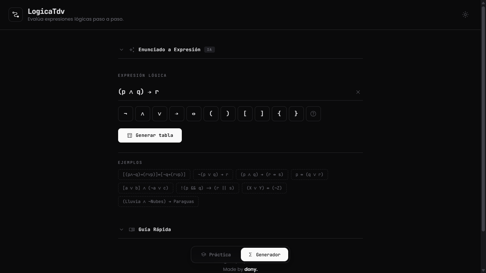

# LogicaTdv

Genera la tabla de verdad de una expresión de lógica proposicional, columna por columna, y
te deja practicar rellenándola a mano. Corre entero en el navegador, sin cuenta ni
servidor propio: [logicatdv.vercel.app](https://logicatdv.vercel.app).



## Cómo se usa

Escribe una expresión como `¬(p ∨ q) → r` y pulsa Enter. La tabla tiene una columna por
cada variable y otra por cada subexpresión, en el orden en que se evalúan, así que se lee
de izquierda a derecha como una resolución en papel. Si una subexpresión aparece dos veces,
ocupa una sola columna. El límite es de 10 variables, que son 1024 filas.

El modo práctica arma la misma tabla con las celdas vacías. Cada clic en una celda pasa de
vacía a V, de V a F y de F otra vez a vacía, y «Verificar» marca qué celdas están bien y
cuáles no. Los dos modos usan el mismo evaluador, así que la corrección nunca contradice a
la tabla generada.

Un enlace con `?expr=` abre la tabla ya resuelta, lo que sirve para compartir un ejercicio:
[`/generate?expr=(p -> q) & ~r`](https://logicatdv.vercel.app/generate?expr=(p%20-%3E%20q)%20%26%20~r).

### De enunciado a expresión

Si el problema viene en palabras, la sección «Enunciado a Expresión» lo formaliza con
Gemini: escribes «Si no llueve, salgo a correr» y la expresión aparece en el campo, lista
para generar la tabla. Necesita una API key de
[Google AI Studio](https://aistudio.google.com/apikey). Si la guardas, queda en el
`localStorage` de tu navegador, y las peticiones van de ahí a Google sin pasar por ningún
servidor de este proyecto. Los modelos Flash entran en el tier gratuito de la API; Gemini
3.1 Pro es de pago.

## Sintaxis

No hace falta teclear los símbolos lógicos. Cada operador acepta varias formas:

| Operador | Símbolo | También vale |
|---|---|---|
| Negación | `¬` | `!`, `~`, `not` |
| Conjunción | `∧` | `&`, `&&`, `*`, `·`, `and` |
| Disyunción | `∨` | `+`, `\|\|`, `or` |
| Condicional | `→` | `->`, `=>` |
| Bicondicional | `↔` | `<->`, `<=>`, `⇔` |

Los corchetes y las llaves cuentan como paréntesis. Sin paréntesis, `¬` liga más fuerte que
`∧`, este más que `∨`, este más que `→` y este más que `↔`. `¬` y `→` agrupan por la
derecha: `p → q → r` es `p → (q → r)`.

Una variable es una palabra hecha solo de letras, tildes incluidas, así que `Lluvia` o
`camión` valen pero `p1` no. Las columnas de variables salen en orden alfabético.

## Desarrollo

Hace falta Node.js 22.22.3 o posterior en la rama 22, 24.15.0 o posterior en la 24, o
cualquier 26 en adelante.

```bash
git clone https://github.com/dony-aep/logica-tdv.git
cd logica-tdv
npm install
npm start
```

El servidor de desarrollo queda en `http://localhost:4200/`. Otros comandos:

```bash
npm run build              # build de producción en dist/
npx ng test --watch=false  # pruebas con Vitest, una sola pasada
```

Está hecho con Angular 22 (componentes standalone, signals y sin zone.js) y TypeScript 6.
Usa `@google/genai` para hablar con Gemini y Vercel Analytics para contar visitas.

Toda la lógica está en `src/app/services/truth-table.service.ts`: normaliza la sintaxis,
convierte la expresión a notación polaca inversa y la evalúa fila por fila. Los componentes
de `src/app/components/` solo muestran el resultado y recogen lo que escribes. La llamada a
Gemini está en `src/app/services/gemini.service.ts`.

---

Hecho por **dony**.
